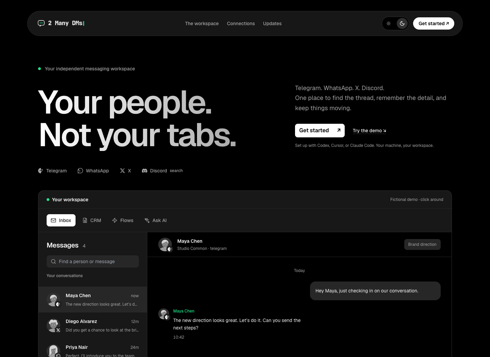
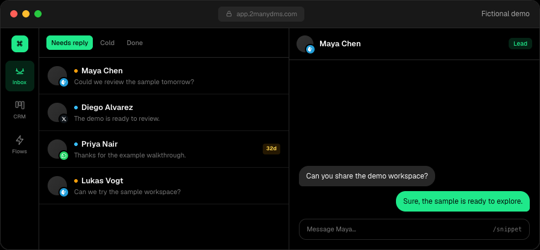
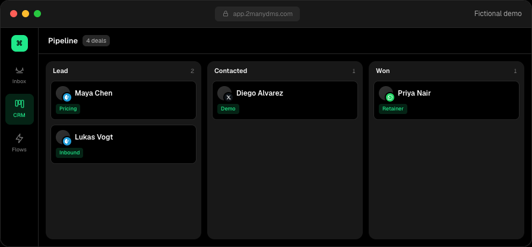
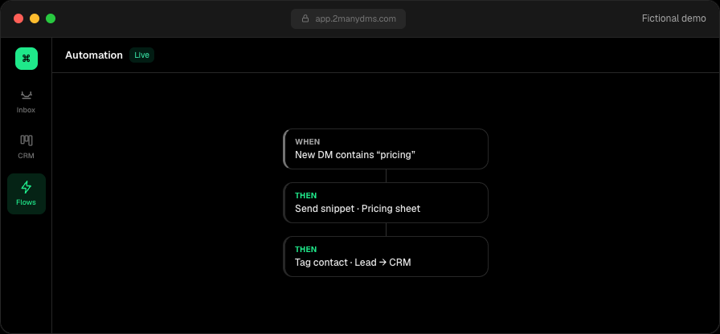

<div align="center">

<picture>
  <source media="(prefers-color-scheme: dark)" srcset="public/brand/lockup-dark.png" />
  
</picture>

### One inbox for every DM — with a CRM built in.

Sync **Telegram**, **WhatsApp**, **X**, **Gmail**, permitted **Discord bot** channels, and optional **read-only Discord private-message search** into a self-hosted workspace.
Triage by who owes a reply, run a pipeline, and automate follow-ups.

<br/>



All product previews below use fictional names and messages, never connected accounts.

<br/>


</div>

---

## Why

Your leads live across Telegram, WhatsApp and X — and they all drop into separate apps with separate
notification badges. **2 Many DM's** pulls every DM into one inbox and adds the layer those apps are
missing: a CRM. It knows whose turn it is to reply, surfaces conversations going cold, lets you drag
contacts through a deal pipeline, and fires automations off keywords — all running on **your** box,
with **your** keys, no SaaS in the middle.

## Features

### New in 0.6.2

Live Discord private-message search with a guided local sign-in, clearer onboarding for all four
messaging platforms, X photo and voice-note recovery, Telegram media recovery, better avatar fetching,
and correct direct-chat identity when opening WhatsApp group members. Read the
[complete connection walkthrough](docs/connection-setup.md) for exact steps, troubleshooting, and hosting limitations.

### New in 0.6.1

Guided Telegram, WhatsApp and X setup with clear prerequisites, recoverable errors, safe retries,
live connection checks, and per-account session isolation. Setup works from the welcome screen and
existing Connections panel. See [Connecting your channels](#connecting-your-channels).

### New in 0.6.0

A redesigned inbox with a collapsible avatar rail, compact auto-growing composer, clearer direct messages,
and sender identities in group chats. Includes local OCR search, inline GIFs and stickers, shared media,
chat-history retention, sync-health indicators, a people network, and optional mobile and Mac companions.

This is the standalone messaging product. No connected accounts, chat archives, client exports, or login
sessions are included. Set up your own connections after installing.

Before upgrading an existing installation, back up its database and session directories. Startup stops if
a schema change requires data loss; review that migration manually rather than forcing a reset. The
optional demo seed clears existing demo tables, so use it only with a fresh, disposable database.

### 🗂️ Turn-based triage inbox
Every chat is sorted by **whose turn it is** — *Needs reply* vs *Cold* — so you never drop a lead.
Snooze, mark done, and a "going cold" badge flags anyone you've left waiting.



### 📊 CRM pipeline board
Drag contacts through **Lead → Contacted → Won**. A real deal pipeline, or group by tag.



### ⚡ Node automations
Visual flows: a **trigger** (keyword, no-reply, new chat, broadcast) chained to **actions** —
send a snippet, tag, or set status. Dry-run before you arm it.



### …and the rest
- **⌘K command search** — fuzzy-search every chat, multi-select, bulk-add to folders.
- **Contacts & relations** — company, email, phone, notes, tags, and links between people and chats.
- **Snippets & composer** — saved replies with ⌘-key shortcuts, a `/` picker, emoji, and platform-aware attachments.
- **Two-way read sync** — read on your phone and the badge clears here; open it here and it marks read on the platform.
- **Encrypted sessions** — login sessions are encrypted at rest (AES-256-GCM).
- **True-black dark mode** with a circular-reveal theme toggle.

## Deploy in one paste

The landing page has **"Deploy with Claude Code / Codex"** buttons that copy a ready-to-paste prompt.
Drop it into your coding agent and it clones, configures the env, and ships. The prompt is simply:

```
Clone and deploy https://github.com/AZK65/2-Many-DMs for me: npm install, copy .env.example
to .env and fill DATABASE_URL + TELEGRAM_API_ID/API_HASH + APP_ENCRYPTION_KEY (openssl rand -hex 32),
run npx prisma db push, then deploy with the included Dockerfile (Railway works great — see railway.json).
Run the sync worker (npm run sync) alongside the web server.
```

## Quick start (local)

```bash
git clone https://github.com/AZK65/2-Many-DMs.git
cd 2-Many-DMs
npm install

cp .env.example .env          # then fill in the values below
npx prisma db push            # create the SQLite schema
npm run db:seed               # optional: demo data to click around

npm run dev                   # web app  →  http://localhost:3000
npm run sync                  # in a second terminal: the channel sync worker
```

Open `http://localhost:3000` for the inbox, `/board` for the pipeline, `/automations` for flows,
and `/landing` for the marketing page.

### Updates

OmniCRM checks its authenticated Git upstream when the app opens, every ten minutes, and whenever
the tab becomes active again. Incoming commit titles appear in the update card before anything is
installed. Local installations can fast-forward, install dependencies, apply Prisma changes, and
build with one click. Private-repository credentials remain in Git/your OS credential helper and are
never sent to the browser. Updates stop safely if the installation has local code changes or commits.

Set `ALLOW_SELF_UPDATE=0` to disable one-click updates. Supervised production installs can set
`ALLOW_SELF_UPDATE=1` and optionally `UPDATE_RESTART_CMD` so the new build restarts automatically.

## Connecting your channels

| Channel | How it links |
| --- | --- |
| **Telegram** | Open **Connect Telegram**. The wizard helps you create your own app at [Telegram API tools](https://my.telegram.org/apps), then enter its API ID/hash, international phone number, login code, and two-step password if enabled. App credentials and the session are encrypted on your server after sign-in. Existing environment-based setups still work. |
| **WhatsApp** | Choose **Connect WhatsApp**, have your phone ready, and scan the live QR from **WhatsApp → Linked devices → Link a device**. On Android, Linked devices is in the three-dot menu; on iPhone, in Settings. Expired QR codes can be regenerated without deleting saved sessions. |
| **X / Twitter** | Choose **Connect X**. Download the bundled connector, install it unpacked in Chrome/Edge, sign in on X, then copy the exact App URL and short-lived pairing code into the connector. Return to setup to confirm live sync. If X Chat is locked, enter your existing numeric X Chat passcode—not your account password. |
| **Discord** | Choose **Open Discord sign-in** on the host computer for live, read-only private-message search. A desktop and Chrome are required; headless VPS login is not supported. Official server bots remain a separate option. See the [full guide](docs/connection-setup.md#discord-private-search). |

Start at `/welcome`, or add another account from **Connections**. Saved accounts can be reopened to finish linking.
Setup shows **Connected and ready** only after the sync worker confirms it. Older messages may
continue importing afterward; a ready connection is not a complete-history guarantee.

These personal-session connectors can be interrupted by provider security checks, rate limits, device
revocation, or network failures. They do not bypass those restrictions. Setup displays recovery guidance
and paces retries; it never automatically repeats login codes or rejected X Chat passcodes.

**Server checklist:** keep the web app and sync worker on the same persistent data directory, preserve
`APP_ENCRYPTION_KEY` across restarts, and back up the database plus connector session directories.
Do not run two workers against the same session. This version is single-owner, not a public multi-user
service: remote hosts require a private owner connection (for example, an SSH tunnel exposing the app
as localhost). The public marketing deployment and invited read-only CRM view cannot connect accounts.

## Environment

All config lives in `.env` (see [`.env.example`](.env.example)). The essentials:

| Variable | What it's for |
| --- | --- |
| `DATABASE_URL` | SQLite path, e.g. `file:./dev.db` (or a mounted volume in prod). |
| `TELEGRAM_API_ID` / `TELEGRAM_API_HASH` | Optional Telegram defaults; the setup wizard can save credentials per account instead. |
| `TELEGRAM_SESSION` | Filled in by `npm run tg:login`. |
| `APP_ENCRYPTION_KEY` | 64-hex-char key to encrypt stored sessions. **Required in production.** |
| `X_AUTH_TOKEN` / `X_CT0` | X session cookies (or use `x:login` / the extension). |
| `DISCORD_ENABLED` / `DISCORD_BOT_TOKEN` | Optional env-based official Discord bot connection (the Connections UI can store the token encrypted instead). |
| `PROXY_URL` | Optional sticky residential proxy for the WhatsApp/X browsers. |

## Deploy (Railway / Docker)

The repo ships a `Dockerfile` (with system Chromium for the WhatsApp/X browsers), a `railway.json`,
and a `start.js` that runs `prisma db push` on boot. One container runs both the web server and the
sync worker. Mount a volume at `/data` and point `DATABASE_URL` / `DATA_DIR` at it so your DB and
login sessions survive restarts.

## Architecture

```
Next.js app (App Router)  ──┐
                            ├── Prisma / SQLite  (conversations, contacts, automations)
Sync worker (tsx)         ──┘
  ├── Telegram  (GramJS / MTProto)
  ├── WhatsApp  (Baileys or whatsapp-web.js + Puppeteer)
  ├── X         (Puppeteer + stealth + fingerprint injection)
  └── Discord   (official bot connector; optional read-only private-message search)
```

### iOS / TestFlight

The repository includes a native React Native app in [`mobile/`](mobile/). The iPhone app connects to this same self-hosted backend through **Tailscale Serve**; Prisma/SQLite, channel sessions, media, and sync workers remain on the private host. Run `npm run start:private`, then `npm run mobile:serve`, and enter the HTTPS tailnet URL in the app. See [`mobile/README.md`](mobile/README.md) for local iOS and TestFlight instructions.

## Security & privacy

- Your archive is stored on your server. Connected platforms receive the requests needed to sync and send messages.
- Login sessions are **encrypted at rest** (AES-256-GCM via `APP_ENCRYPTION_KEY`).
- `.env`, databases, and session folders are excluded from Git and Docker builds.
  Run `npm run privacy:check` before publishing; ignores do not remove files already committed.
- Read the [release privacy checklist](docs/release-privacy.md) before sharing a fork, screenshot, or diagnostic report.

## Custom integrations & support

Report a bug or suggest an integration through [GitHub issues](https://github.com/AZK65/2-Many-DMs/issues).
Do not post private messages, customer information, login codes, or session files.

## License

[MIT](LICENSE).
